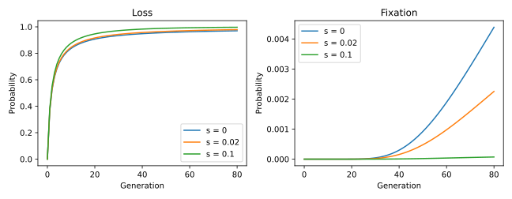

# Allele loss under selection

How does selection change the fate of a new allele? Start with one copy in a
population of 32 diploid individuals and follow its loss and fixation
probabilities for 80 generations. Compare neutrality with two additive fitness
penalties. Population size is constant, and there is no mutation or immigration.



## Calculation

After [installing drifft](../index.md#installation), save the code below as
`allele_loss.py` and run `uv run --with matplotlib python allele_loss.py`.
Matplotlib is needed only for plotting.

```python
import jax
import jax.numpy as jnp
import matplotlib.pyplot as plt
import drifft

jax.config.update("jax_enable_x64", True)
M = 64  # 32 diploid individuals.
generations = 80
backend = drifft.FFT(M)
initial = jnp.zeros(M + 1).at[1].set(1.0)
fig, axes = plt.subplots(1, 2, figsize=(9, 3.5))

for s in [0.0, 0.02, 0.1]:
    transition = drifft.Transition(
        backend, drifft.AdditiveSelection(s=s)
    )
    distribution = initial
    loss = [float(distribution[0])]
    fixation = [float(distribution[-1])]
    for _ in range(generations):
        distribution = transition.advance(distribution)
        loss.append(float(distribution[0]))
        fixation.append(float(distribution[-1]))
    assert jnp.isclose(distribution.sum(), 1.0, atol=1e-10)
    label = f"s = {s:g}"
    axes[0].plot(range(generations + 1), loss, label=label)
    axes[1].plot(range(generations + 1), fixation, label=label)
    print(f"{label}: loss={loss[-1]:.4f}, fixation={fixation[-1]:.4f}")

for ax, title in zip(axes, ["Loss", "Fixation"]):
    ax.set(xlabel="Generation", ylabel="Probability", title=title)
    ax.legend()
fig.tight_layout()
fig.savefig("allele_loss.svg")
plt.show()
```

## Interpretation

The first entry of the distribution is the probability of loss; the last is
fixation. These endpoints are absorbing here, so both probabilities accumulate
over time. Their sum can be less than one because some trajectories are still
segregating at generation 80.

The curves show increased loss and reduced fixation as the fitness penalty
grows. The neutral allele can also be lost: disappearance from a single initial
copy does not require selection. The two panels use different vertical scales
so the much smaller fixation probabilities remain visible.

`AdditiveSelection(s)` gives fitnesses $(1,1-s/2,1-s)$.
These are finite-time probabilities, not estimates of eventual fixation.
The code propagates the full distribution; it does not simulate individual
trajectories or discard endpoint mass.

See [selection and mutation](../guide/frequency_maps.md) for other fitness models
and [computing transitions](../guide/transitions.md) for endpoint semantics.
