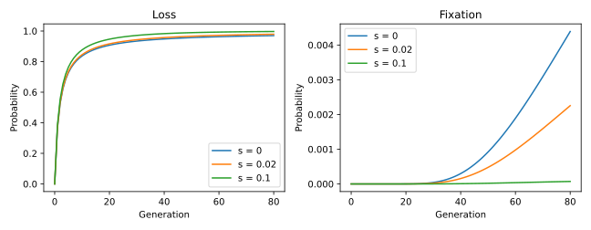

# Allele loss under selection

How does selection change the fate of a new allele? Start with one copy in a
population of 32 diploid individuals and follow its loss and fixation
probabilities for 80 generations. Compare neutrality with two additive fitness
penalties. Population size is constant, with no mutation or added source mass.



## Calculation

After [installing drifft](../index.md#installation), save the code below as
`allele_loss.py` and run `uv run --with matplotlib python allele_loss.py`.
Matplotlib is needed only for plotting.

```python
import jax
import jax.numpy as jnp
import matplotlib.pyplot as plt
import drifft

jax.config.update("jax_enable_x64", True)
generations = 80
backend = drifft.FFT(pop_size=32)
fig, axes = plt.subplots(1, 2, figsize=(9, 3.5))

for s in [0.0, 0.02, 0.1]:
    transition = drifft.Transition(backend, drifft.AdditiveSelection(s=s))
    distribution = jnp.zeros(transition.source_size()).at[1].set(1.0)
    loss = [float(distribution[0])]
    fixation = [float(distribution[-1])]
    for _ in range(generations):
        distribution = transition.advance(distribution)
        loss.append(float(distribution[0]))
        fixation.append(float(distribution[-1]))
    assert jnp.isclose(distribution.sum(), 1.0, rtol=0, atol=1e-10)
    label = f"s = {s:g}"
    axes[0].plot(range(generations + 1), loss, label=label)
    axes[1].plot(range(generations + 1), fixation, label=label)
    print(f"{label}: loss={loss[-1]:.4f}, fixation={fixation[-1]:.4f}")

for ax, title in zip(axes, ["Loss", "Fixation"]):
    ax.set(xlabel="Generation", ylabel="Probability", title=title)
    ax.legend()
fig.tight_layout()
fig.savefig("allele_loss.svg")
plt.show()
```

## Interpretation

The curves show finite-time loss and fixation probabilities for fitnesses
$(1,1-s/2,1-s)$. The full distribution retains absorbed mass; trajectories still
segregating at generation 80 account for the remaining probability. The panels
use different vertical scales to show the smaller fixation probabilities.

See [selection and mutation](../api/frequency_maps.md) for other fitness models
and [computing transitions](../api/transitions.md) for endpoint semantics.
