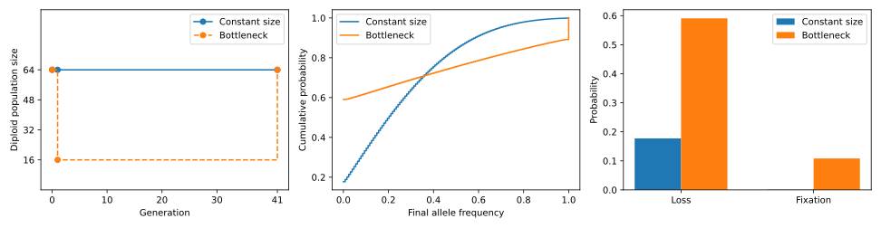

# A population bottleneck

Does a temporary reduction in population size change allele frequencies when
there is no selection? Compare a bottleneck with a constant-size population,
starting at allele frequency $1/4$. Both histories last 41 generations, begin
and end at 64 diploid individuals, and use neutral reproduction without mutation.



## Calculation

After [installing `drifft`](../index.md#installation), save the code below as
`bottleneck.py` and run `uv run --with matplotlib python bottleneck.py`.
Matplotlib is needed only for plotting.

```python
import jax
import jax.numpy as jnp
import matplotlib.pyplot as plt
import drifft

jax.config.update(
    "jax_enable_x64", True
)  # Use float64 for the probability checks below.
# Sizes are diploid; boundaries occur at generations 1 and 1 + 40 = 41.
histories = {
    "Constant size": drifft.Demography(pop_sizes=[64, 64, 64], generations=[1, 40]),
    "Bottleneck": drifft.Demography(pop_sizes=[64, 16, 64], generations=[1, 40]),
}
# 64 diploid individuals have 128 gene copies, with possible counts 0 through 128.
initial = (
    jnp.zeros(129).at[32].set(1.0)
)  # Start with exactly 32 copies (frequency 1/4).
frequencies = jnp.arange(129) / 128
fig, axes = plt.subplots(1, 3, figsize=(13.5, 3.5))

for index, (label, history) in enumerate(histories.items()):
    # Hold each size until the next boundary; recovery occurs at the final generation.
    times = jnp.concatenate(
        (jnp.array([0]), jnp.cumsum(jnp.array(history.generations)))
    )
    axes[0].step(
        times,
        history.pop_sizes,
        where="post",
        marker="o",
        label=label,
        linestyle="-" if index == 0 else "--",
    )
    # Prepare the count grids for this history before applying its biological model.
    geometry = history.prepare(backend_factory=drifft.FFT)
    model = drifft.DemographicTransition(
        geometry,
        method=drifft.Sequential(),  # Apply reproduction one generation at a time.
        frequency_map=drifft.Neutral(),  # Isolate drift: no selection or mutation.
    )
    # Propagate the entire count distribution through all 41 generations.
    result = model.advance(initial)
    assert result.converged
    distribution = result.distribution
    # Weight final frequencies by their probabilities to compute the moments.
    mean = distribution @ frequencies
    variance = distribution @ (frequencies - mean) ** 2
    # Neutral drift preserves total probability and mean frequency, even as size changes.
    assert jnp.isclose(distribution.sum(), 1.0, rtol=0, atol=1e-10)
    assert jnp.isclose(mean, 0.25, rtol=0, atol=1e-10)
    print(
        f"{label}: mean={mean:.4f}, variance={variance:.4f}, "
        f"loss={distribution[0]:.4f}, fixation={distribution[-1]:.4f}"
    )
    # The CDF includes all outcomes, including loss at zero and fixation at one.
    axes[1].step(frequencies, jnp.cumsum(distribution), where="post", label=label)
    offset = (index - 0.5) * 0.35  # Place the two histories' bars side by side.
    # Show the endpoint probabilities separately to make absorption easier to compare.
    axes[2].bar(
        jnp.array([0.0, 1.0]) + offset,
        jnp.array([distribution[0], distribution[-1]]),
        width=0.35,
        label=label,
    )

axes[0].set(
    xlabel="Generation",
    ylabel="Diploid population size",
    xticks=[0, 10, 20, 30, 41],
    yticks=[16, 32, 48, 64],
    ylim=(0, 96),
)
axes[1].set(xlabel="Final allele frequency", ylabel="Cumulative probability")
axes[2].set(xticks=[0, 1], xticklabels=["Loss", "Fixation"], ylabel="Probability")
for ax in axes:
    ax.legend()
fig.tight_layout()
fig.savefig("bottleneck.svg")
plt.show()
```

## Interpretation

The bottleneck increases variance and endpoint probabilities while preserving
mean frequency $1/4$. The left panel shows the two population histories. The
middle panel's CDF includes loss and fixation; the right panel shows those
masses separately.

## When the size changes

Sizes run oldest to newest. Each interval holds its source size until its
final generation, when the next size takes effect. For the bottleneck above:

| Generations | Reproduction |
| --- | --- |
| 1 | Change from 64 to 16 diploid individuals. |
| 2–40 | Reproduce at size 16. |
| 41 | Change from 16 to 64; take the final output. |

Each boundary step includes selection (neutral here) and binomial reproduction.
There is no extra resampling or subsequent evolution at the final size.

The same elapsed time and final allele-count grid make the two outputs directly
comparable. See [population histories](../api/demography.md) for the timing
convention and [the Wright–Fisher model](../guide/model.md) for the probability law.
