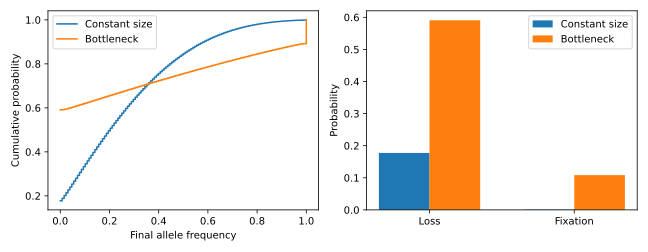

# A population bottleneck

Does a temporary reduction in population size change allele frequencies when
there is no selection? Compare a bottleneck with a constant-size population,
starting at allele frequency $1/4$. Both histories last 41 generations, begin
and end at 64 diploid individuals, and use neutral reproduction without mutation.



## Calculation

After [installing drifft](../guide/installation.md), save the code below as
`bottleneck.py` and run `uv run --with matplotlib python bottleneck.py`.
Matplotlib is needed only for plotting.

```python
import jax
import jax.numpy as jnp
import matplotlib.pyplot as plt
import drifft

jax.config.update("jax_enable_x64", True)
histories = {
    "Constant size": drifft.Demography(ne=[64, 64, 64], generations=[1, 40]),
    "Bottleneck": drifft.Demography(ne=[64, 16, 64], generations=[1, 40]),
}
initial = jnp.zeros(129).at[32].set(1.0)  # Initial frequency is 1/4.
frequencies = jnp.arange(129) / 128
fig, axes = plt.subplots(1, 2, figsize=(9, 3.5))

for index, (label, history) in enumerate(histories.items()):
    model = drifft.DemographicTransition(
        history,
        backend=drifft.FFT,
        method=drifft.Sequential(),
        frequency_map=drifft.Neutral(),
    )
    result = model.advance(initial)
    assert result.converged
    distribution = result.distribution
    mean = distribution @ frequencies
    variance = distribution @ (frequencies - mean)**2
    assert jnp.isclose(distribution.sum(), 1.0, atol=1e-10)
    assert jnp.isclose(mean, 0.25, atol=1e-10)
    print(f"{label}: mean={mean:.4f}, variance={variance:.4f}, "
          f"loss={distribution[0]:.4f}, fixation={distribution[-1]:.4f}")
    axes[0].step(frequencies, jnp.cumsum(distribution), where="post", label=label)
    offset = (index - 0.5) * 0.35
    axes[1].bar(jnp.array([0.0, 1.0]) + offset,
                jnp.array([distribution[0], distribution[-1]]),
                width=0.35, label=label)

axes[0].set(xlabel="Final allele frequency", ylabel="Cumulative probability")
axes[1].set(xticks=[0, 1], xticklabels=["Loss", "Fixation"], ylabel="Probability")
for ax in axes:
    ax.legend()
fig.tight_layout()
fig.savefig("bottleneck.svg")
plt.show()
```

## Interpretation

The mean allele frequency remains $1/4$ in both calculations, while the
bottleneck increases the variance and the probabilities of loss and fixation.
Neutral drift changes the distribution even when it preserves its mean.

The left panel shows the complete cumulative distribution, including the mass
at loss and fixation. The right panel displays those endpoint probabilities
separately. Expanding the population again does not restore lost variation: an
absorbed allele cannot reappear in this model.

!!! note "When the size changes"

    Generation 1 changes the bottleneck population from 64 to 16 diploid
    individuals. Generations 2–40 reproduce at size 16; generation 41 changes
    back to size 64. The output is taken immediately after that final generation.

The same elapsed time and final allele-count grid make the two outputs directly
comparable. See [population histories](../guide/demography.md) for the timing
convention and [the Wright–Fisher model](../guide/model.md) for the probability law.
