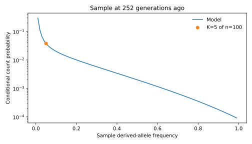

# Sample likelihoods under a Schiffels–Durbin history

Compute a sample allele-count likelihood by averaging hypergeometric sampling
probabilities over the population distribution. For population count $J$,
$M$ population gene copies, and a sample of $n$ copies without replacement,

$$
L(k)=\Pr(K=k)=\sum_{j=0}^{M}\Pr(J=j)
\frac{\binom jk\binom{M-j}{n-k}}{\binom Mn}.
$$

For sites ascertained as segregating in the sample, use

$$
L(k\mid 1\le K<n)=\frac{L(k)}{\sum_{l=1}^{n-1}L(l)}.
$$

## Model and history

The [bundled history](data/schiffels_durbin.tsv) preserves the values previously
embedded in this example, attributed there to `inferred_demography_5.tsv`.
Its population and original inference settings are undocumented; treat it as
an illustrative input, not a uniquely identified history from the cited papers.

Selection is additive with fitnesses $(1,0.9999,0.9998)$. Recurrent mutation
at $10^{-8}$ in each direction occurs before selection. The derived allele
starts absent at the oldest boundary, 55,940 generations ago. This ancestral
condition and both mutation rates are part of the likelihood.

!!! note "Sample time"

    The example samples 100 gene copies **252 generations ago**, before the
    large recent expansion. Setting `end_time = 0` in the script includes the
    full history with nearest-integer sizes and boundaries. That calculation
    ends at over 51 million gene copies and needs substantially more memory
    and separate numerical validation.

## Calculation

The calculation uses Jacobi and RationalKrylov within intervals and FFT at
size changes. A prepared [HypergeometricSampling](../api/sampling.md) operator
then projects the final population distribution to 100 sampled gene copies.
The complete code, including plotting, is shown below
and available as a [Python script](schiffels_durbin.py).

Sampling geometry depends only on population size, sample size, and accuracy
settings; reuse it across parameter evaluations. The projection and likelihood
arithmetic stay in JAX. Sample-segregating conditioning is applied after sampling,
so its denominator is the probability of a segregating sample.

After [installation](../index.md#installation), run from the repository root:

```bash
uv run --with matplotlib python docs/examples/schiffels_durbin.py
```

To run a standalone copy, save the code as `schiffels_durbin.py` beside a
`data/` directory containing the [demographic table](data/schiffels_durbin.tsv).
An earlier full run using SciPy sampling used about 5.1 GB of memory; see the
[measurement details](../benchmarks.md#schiffelsdurbin-likelihood-calculation).

```python
"""Compute and plot sample likelihoods for the bundled demographic history."""

from pathlib import Path

import jax
import jax.numpy as jnp
import matplotlib.pyplot as plt
import numpy as np

import drifft

jax.config.update("jax_enable_x64", True)

# Bundled example history; see the documentation for provenance limitations.
history_data = np.loadtxt(
    Path(__file__).with_name("data") / "schiffels_durbin.tsv",
    delimiter="\t",
    skiprows=1,
)
raw_time, raw_ne = history_data.T

# The default run ends before the large recent expansion.
end_time = 252
keep = raw_time >= end_time
ne = np.rint(raw_ne[keep]).astype(int).tolist()
boundaries = np.rint(raw_time[keep]).astype(int)
generations = (boundaries[:-1] - boundaries[1:]).tolist()
history = drifft.Demography(ne=ne, generations=generations)
print(f"History endpoint: {boundaries[-1]} generations ago")

frequency_map = drifft.Composition(
    drifft.Mutation(forward_rate=1e-8, backward_rate=1e-8),
    drifft.AdditiveSelection(s=2e-4),
)
model = drifft.DemographicTransition(
    history,
    backend_factory=drifft.Jacobi,
    boundary_backend_factory=drifft.FFT,
    method=drifft.RationalKrylov(dimension=128, rtol=1e-10, atol=1e-13),
    frequency_map=frequency_map,
)

# Explicit ancestral condition: the derived allele is absent at the oldest boundary.
initial = jnp.zeros(2 * history.initial_ne + 1).at[0].set(1.0)
result = model.advance(initial, throw=False)
# In practice, check result.converged and that population mass is finite and sums to one.
population_probabilities = result.distribution

# Sample 100 gene copies without replacement from the endpoint population.
sample_size = 100
observed_count = 5  # Illustrative observation, not an empirical dataset.
M = 2 * history.final_ne
sampling = drifft.HypergeometricSampling(
    population_gene_copies=M,
    sample_gene_copies=sample_size,
    accuracy=1e-10,
)
sample_probabilities = sampling.advance(population_probabilities)
# In practice, check sample mass and positivity before conditioning or taking logs.

# Condition only if the observation scheme selects sample-segregating sites.
segregating = sample_probabilities[1:-1]
conditional_probabilities = segregating / segregating.sum()
likelihood = sample_probabilities[observed_count]
conditional_likelihood = conditional_probabilities[observed_count - 1]
print(f"P(K={observed_count}) = {likelihood:.6g}")
print(f"Log likelihood = {jnp.log(likelihood):.6g}")
print(f"P(K={observed_count} | sample segregating) = {conditional_likelihood:.6g}")

counts = np.arange(1, sample_size)
fig, ax = plt.subplots(figsize=(7, 4))
ax.plot(counts / sample_size, conditional_probabilities, label="Model")
ax.scatter(
    [observed_count / sample_size],
    [conditional_likelihood],
    color="C1",
    zorder=3,
    label=f"K={observed_count} of n={sample_size}",
)
ax.legend(frameon=False)
ax.set(
    xlabel="Sample derived-allele frequency",
    ylabel="Conditional count probability",
    yscale="log",
    title=f"Sample at {boundaries[-1]} generations ago",
)
fig.tight_layout()
fig.savefig("schiffels_durbin_likelihood.svg")
plt.show()
```

Recorded output:

```text
History endpoint: 252 generations ago
P(K=5) = 4.12985e-05
Log likelihood = -10.0947
P(K=5 | sample segregating) = 0.03798
```



The observation of five derived copies is illustrative. The plot uses
sample-segregating ascertainment and requires an identified derived allele.
The full population distribution retains endpoint mass and permits re-entry
through recurrent mutation. This is a finite-allele likelihood, not an
infinite-sites spectrum with singleton immigration or MSMC's likelihood for
inferring demography. Multisite composite-likelihood uncertainty requires
separate treatment of linkage and ascertainment.

## Numerical checks

Validate the sample probabilities under larger Krylov dimensions and tighter
backend settings using the [accuracy guide](../guide/numerics.md). Tighten
sampling `accuracy` separately; its row-error budget does not bound relative
errors in rare sample bins or conditional likelihoods. See the
[sampling method](../methods/hypergeometric.md) for the approximation contract.

For this default history, sampling at `accuracy=1e-10` agreed with a SciPy
hypergeometric reference to a maximum relative difference of $4.2\times10^{-11}$
across both unconditional and sample-segregating probabilities. Both
log-likelihood differences were below $4.0\times10^{-11}$. Tightening sampling
to `1e-12` reduced the maximum relative difference below $1.2\times10^{-14}$.
These comparisons use the same evolved population distribution and validate
the sampling step, not demographic evolution or parameter gradients.

[Recorded comparisons and timings](../benchmarks.md#schiffelsdurbin-likelihood-calculation)
include an FFT comparison for this history.

## References

- Schiffels, S., and Durbin, R. (2014). *Inferring human population size and
  separation history from multiple genome sequences*. Nature Genetics **46**,
  919–925. [doi:10.1038/ng.3015](https://doi.org/10.1038/ng.3015).
- Spence, J. P., Zeng, J., Mostafavi, H., and Pritchard, J. K. (2023).
  *Scaling the discrete-time Wright–Fisher model to biobank-scale datasets*.
  Genetics **225**, iyad168. [doi:10.1093/genetics/iyad168](https://doi.org/10.1093/genetics/iyad168).
