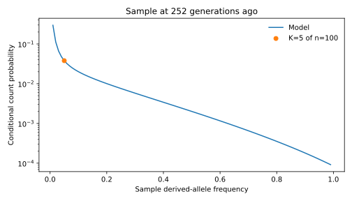

# Sample likelihoods under a Schiffels–Durbin history

What is the likelihood of observing a derived allele at a particular sample
frequency under selection, mutation, and a changing population size? Propagate
the population allele-count distribution with `Demography` and
`DemographicTransition`, then average the sampling probability over that
uncertain population count.

The history below is hardcoded from the supplied `inferred_demography_5.tsv`.
Selection is additive, with genotype fitnesses $(1,0.9999,0.9998)$; mutation
occurs in both directions at $10^{-8}$ per gene copy per generation. Mutation
is applied before selection. The ancestral starting distribution is explicit:
the derived allele is absent at the oldest boundary, 55,940 generations ago.
This is a finite-allele model with recurrent mutation, not an infinite-sites
spectrum with singleton immigration.

!!! note "Endpoint and integer population sizes"

    The default calculation stops at 252 generations ago. It does not include
    the subsequent expansion or predict a present-day sample. All table rows
    are included below; setting `end_time = 0` includes the full history, with
    nearest-integer sizes and boundaries. That explicit discretization changes
    the noninteger recent rows. The final population then has over 51 million
    gene copies and requires much larger geometries and separate numerical
    validation.



*Probabilities conditional on the sample segregating, for 100 gene copies
sampled 252 generations ago. The marker highlights the illustrative observation
of 5 derived copies.*

## Calculation

After [installation](../index.md#installation), save the code as
`schiffels_durbin.py` and run `uv run --with matplotlib python schiffels_durbin.py`.
The human-scale calculation is much larger than the other examples; first check
the code on a small history if your machine has limited memory.

```python
import jax
import jax.numpy as jnp
import matplotlib.pyplot as plt
import numpy as np
from scipy.stats import hypergeom
import drifft

jax.config.update("jax_enable_x64", True)

# Values from inferred_demography_5.tsv, oldest to newest.
raw_ne = np.array([14448, 14068, 14068, 14464, 14464, 15208, 15208, 16256, 16256, 17618, 17618, 19347,
 19347, 21534, 21534, 24236, 24236, 27367, 27367, 30416, 30416, 32060, 32060, 31284,
 29404, 26686, 23261, 18990, 16490, 16490, 12958, 12958, 9827, 9827, 7477, 7477,
 5791, 5791, 4670, 4670, 3841, 3841, 3372, 3372, 3287, 3359, 3570, 4095, 4713, 5661,
 7540, 11375, 14310, 13292, 155864.2976307964, 774549.1670468026, 1987880.2979927266,
 4178762.483537545, 25557808.462783974], dtype=float)
raw_time = np.array([55940, 51395, 47457, 43984, 40877, 38067, 35501, 33141, 30956, 28922, 27018, 25231,
 23545, 21951, 20439, 19000, 17628, 16318, 15063, 13859, 12702, 11590, 10517, 9482,
 8483, 7516, 6580, 5672, 5520, 5156, 4817, 4500, 4203, 3922, 3656, 3404, 3165, 2936,
 2718, 2509, 2308, 2116, 1930, 1752, 1579, 1413, 1252, 1096, 945, 798, 656, 517, 383,
 252, 116.76952415818737, 54.10762607987899, 25.07191170903412, 11.617600000000001,
 0], dtype=float)

# The default run ends before the large recent expansion.
end_time = 252
keep = raw_time >= end_time
ne = np.rint(raw_ne[keep]).astype(int).tolist()
boundaries = np.rint(raw_time[keep]).astype(int)
generations = (boundaries[:-1] - boundaries[1:]).tolist()
history = drifft.Demography(ne=ne, generations=generations)
print(f"History endpoint: {boundaries[-1]} generations ago")

frequency_map = drifft.Composition(
    drifft.Mutation(forward_rate=1e-8, backward_rate=1e-8),
    drifft.AdditiveSelection(s_het=1e-4),
)
model = drifft.DemographicTransition(
    history,
    backend=drifft.Jacobi,
    boundary_backend=drifft.FFT,
    method=drifft.RationalKrylov(dimension=128, rtol=1e-10, atol=1e-13),
    frequency_map=frequency_map,
)

# Explicit ancestral condition: the derived allele is absent at the oldest boundary.
initial = jnp.zeros(2 * history.initial_ne + 1).at[0].set(1.0)
result = model.advance(initial, throw=False)
if not bool(result.converged):
    raise RuntimeError(f"demographic evolution failed: {result.status}")
population_probabilities = np.asarray(result.distribution)
if not np.all(np.isfinite(population_probabilities)):
    raise RuntimeError("nonfinite population probabilities")
if not np.isclose(population_probabilities.sum(), 1.0, atol=1e-8, rtol=0):
    raise RuntimeError("population mass check failed")

# Sample 100 gene copies without replacement from the endpoint population.
sample_size = 100
observed_count = 5  # Illustrative observation, not an empirical dataset.
M = 2 * history.final_ne
if not 1 <= observed_count < sample_size <= M:
    raise ValueError("require 1 <= observed_count < sample_size <= M")
population_counts = np.arange(M + 1)
sample_probabilities = np.empty(sample_size + 1)
for count in range(sample_size + 1):
    weights = hypergeom.pmf(count, M, population_counts, sample_size)
    sample_probabilities[count] = weights @ population_probabilities
if not np.all(np.isfinite(sample_probabilities)):
    raise RuntimeError("nonfinite sample probabilities")
if not np.isclose(sample_probabilities.sum(), 1.0, atol=1e-8, rtol=0):
    raise RuntimeError("sample mass check failed")

# Condition only if the observation scheme selects sample-segregating sites.
segregating = sample_probabilities[1:-1]
if np.any(segregating <= 0):
    raise RuntimeError("nonpositive sample bins; validate numerical accuracy")
conditional_probabilities = segregating / segregating.sum()
likelihood = sample_probabilities[observed_count]
conditional_likelihood = conditional_probabilities[observed_count - 1]
print(f"P(K={observed_count}) = {likelihood:.6g}")
print(f"Log likelihood = {np.log(likelihood):.6g}")
print(f"P(K={observed_count} | sample segregating) = {conditional_likelihood:.6g}")

counts = np.arange(1, sample_size)
fig, ax = plt.subplots(figsize=(7, 4))
ax.plot(counts / sample_size, conditional_probabilities, label="Model")
ax.scatter([observed_count / sample_size], [conditional_likelihood],
           color="C1", zorder=3, label=f"K={observed_count} of n={sample_size}")
ax.legend(frameon=False)
ax.set(xlabel="Sample derived-allele frequency", ylabel="Conditional count probability",
       yscale="log", title=f"Sample at {boundaries[-1]} generations ago")
fig.tight_layout()
fig.savefig("schiffels_durbin_likelihood.svg")
plt.show()
```

The default calculation gives:

```text
History endpoint: 252 generations ago
P(K=5) = 4.12985e-05
Log likelihood = -10.0947
P(K=5 | sample segregating) = 0.03798
```

## From a population distribution to a likelihood

For population allele count $J$ and a sample of $n$ gene copies without
replacement, the expected sampling likelihood of count $k$ is

$$
L(k)=\Pr(K=k)=\sum_{j=0}^{M}\Pr(J=j)
\frac{\binom jk\binom{M-j}{n-k}}{\binom Mn}.
$$

The population distribution includes loss and fixation and has total mass one.
Unlike singleton immigration, recurrent mutation lets trajectories leave those
endpoint states. The initial absence assumption and both mutation rates are
part of this likelihood; another ancestral distribution can change the answer.

If the site was selected because it segregates in the sample, use

$$
L(k\mid 1\le K<n)=\frac{L(k)}{\sum_{l=1}^{n-1}L(l)}.
$$

The plot shows these conditional probabilities at frequencies $k/n$. They are
discrete allele-count probabilities, not a continuous density. Conditioning
removes monomorphic observations from the sample space; it is a modeling choice,
not a repair for numerical mass errors. The derived allele must be identified
for this unfolded likelihood.

For several sites, summing their log likelihoods gives a composite likelihood
if they are treated as independent. Linkage and ascertainment need separate
modeling before using that calculation for uncertainty estimates. This example
does not reproduce MSMC's sequence/coalescent likelihood for inferring demography.

## Numerical checks

Jacobi represents the constant-size intervals in reduced polynomial
coordinates, and `RationalKrylov` advances that reduced state. FFT handles the
single-generation transitions between population sizes. The biological map
is shared by both backends.

For the default history, all 53 interval checks passed with 128 Krylov vectors.
Total probability mass differed from one by $4.3\times10^{-12}$, and every
population and sample bin was positive. Compared with the previous FFT plus
512-vector `PolynomialKrylov` calculation, the likelihood of $K=5$ differed
relatively by $1.3\times10^{-10}$. The largest relative difference across the
conditional sample probabilities was $8.5\times10^{-8}$. These are comparisons
between approximations, not exact-error bounds.

A local float64 CPU run on macOS arm64 measured:

| Stage | Time |
| --- | ---: |
| Geometry setup | 70.7 s |
| JIT tracing and compilation | 57.3 s |
| First synchronized propagation | 44.4 s |
| Synchronized warm propagation | 40.8 s |

The warm call reused the compiled model and restarted from the same ancestral
distribution; both calls gave identical outputs. Timings exclude the sampling
projection and plotting. BLAS/OpenMP thread limits were one, JAX CPU threading
used its default, and persistent compilation caching was disabled. Peak process
memory for the complete run, including both calls, sampling and plotting, was
about 5.1 GB. These single-run measurements do not establish a speedup over
Sequential FFT.

A converged power action is not a certificate for rare-event likelihoods.
Compare the sample probabilities themselves under larger Krylov dimensions and
tighter backend settings. For small histories, compare against Sequential and
a dense binomial reference. Do not clip negative bins or silently normalize the
population distribution. See [accuracy and differentiation](../guide/numerics.md)
for validation and [population histories](../guide/demography.md) for timing.

## References

- Schiffels, S., and Durbin, R. (2014). *Inferring human population size and
  separation history from multiple genome sequences*. Nature Genetics **46**,
  919–925. [doi:10.1038/ng.3015](https://doi.org/10.1038/ng.3015).
- Spence, J. P., Zeng, J., Mostafavi, H., and Pritchard, J. K. (2023).
  *Scaling the discrete-time Wright–Fisher model to biobank-scale datasets*.
  Genetics **225**, iyad168. [doi:10.1093/genetics/iyad168](https://doi.org/10.1093/genetics/iyad168).

The table is the supplied stepwise history, not a unique history specified by
these citations. Record its population and original inference settings when
using the example for an analysis.
