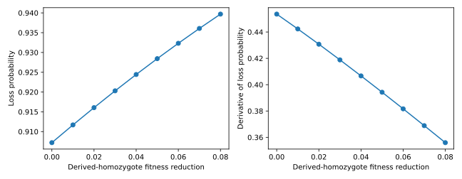

# Sensitivity to selection

How much does selection change the probability that a new allele is lost within
20 generations? Differentiate that finite-time loss probability, then compare
the derivative with central finite differences. The population has 32 diploid
individuals, starts with one derived copy, and has no mutation or added source mass.



## Calculation

After [installing `drifft`](../index.md#installation), save the code below as
`selection_sensitivity.py` and run `uv run --with matplotlib python selection_sensitivity.py`.
Matplotlib is needed only for plotting.

```python
import jax
import jax.numpy as jnp
import matplotlib.pyplot as plt
import drifft

# Enable float64 before preparing geometry; the numerical backends require it.
jax.config.update("jax_enable_x64", True)
# Repeated sizes describe 20 generations at one fixed diploid population size.
history = drifft.Demography(pop_sizes=[32, 32], generations=[20])
# Keep host preparation outside the objective so parameter sweeps reuse geometry.
geometry = history.prepare(backend_factory=drifft.FFT)
# A full count grid includes loss and fixation; start at exactly one derived copy.
initial = jnp.zeros(65).at[1].set(1.0)


def loss_probability(s):
    # Construct selection from the argument so JAX can trace its effect on evolution.
    transition = drifft.DemographicTransition(geometry, drifft.AdditiveSelection(s=s))
    # With no mutation, count zero means the allele was lost by generation 20.
    return transition.advance(initial).distribution[0]


# Compute the scalar probability and d(probability)/ds in one compiled function.
value_and_gradient = jax.jit(jax.value_and_grad(loss_probability))
strengths = jnp.linspace(0.0, 0.08, 9)
values, gradients = [], []
for strength in strengths:
    value, gradient = value_and_gradient(strength)
    values.append(float(value))
    gradients.append(float(gradient))

strength = jnp.asarray(0.02)
value, gradient = value_and_gradient(strength)
print(f"Loss after 20 generations: {value:.6f}")
print(f"Derivative at s=0.02: {gradient:.6f}")
# Check autodiff against central differences at several steps to assess stability.
for step in [1e-4, 1e-5, 1e-6]:
    finite_difference = (
        loss_probability(strength + step) - loss_probability(strength - step)
    ) / (2 * step)
    print(f"step={step:.0e}: finite difference={finite_difference:.6f}")
    assert jnp.isclose(finite_difference, gradient, rtol=1e-5, atol=1e-8)

fig, axes = plt.subplots(1, 2, figsize=(9, 3.5))
axes[0].plot(strengths, values, marker="o")
axes[0].set(xlabel="Derived-homozygote fitness reduction", ylabel="Loss probability")
axes[1].plot(strengths, gradients, marker="o")
axes[1].set(
    xlabel="Derived-homozygote fitness reduction",
    ylabel="Derivative of loss probability",
)
fig.tight_layout()
fig.savefig("selection_sensitivity.svg")
plt.show()
```

## Positive selection in log coordinates

The sweep above includes neutral selection (`s=0`), so it uses ordinary
selection coordinates. For strictly positive selection, we recommend log inputs,
particularly when using Krylov methods. Reuse `loss_probability` from above:

```python
def loss_from_log_selection(log_s):
    return loss_probability(jnp.exp(log_s))


log_s = jnp.log(0.02)
value, log_gradient = jax.jit(jax.value_and_grad(loss_from_log_selection))(log_s)
print("dP(loss)/dlog(s):", log_gradient)
print("dP(loss)/ds:", log_gradient / jnp.exp(log_s))
for step in (0.01, 0.003, 0.001):
    finite_difference = (
        loss_from_log_selection(log_s + step)
        - loss_from_log_selection(log_s - step)
    ) / (2 * step)
    assert jnp.isclose(finite_difference, log_gradient, rtol=1e-4, atol=1e-8)
```

The log derivative equals $s$ times the ordinary derivative. It measures the
change in loss probability per small relative change in selection strength.
Taking logs excludes zero and negative selection and does not enforce the
frequency map's upper bound. For a likelihood with two mutation rates and
selection, see the [log-input JVP example](#likelihood-derivatives-for-mutation-and-selection).
Log inputs can improve numerical scaling, but still require accuracy checks.

## Interpretation

Positive derivatives indicate greater loss probability with increasing fitness
penalty. Each evaluation binds the current selection to the same prepared geometry.
The full distribution retains absorbed mass, so its first entry gives loss
probability by generation 20.

The finite-difference comparison checks differentiation of this numerical
calculation. See [accuracy and differentiation](../guide/numerics.md) for
backend validation and [population histories](../api/demography.md) for
changing-size models.

## Likelihood derivatives for mutation and selection

This small history starts with no derived copies and observes five derived
copies in a sample of 40. Geometry stays outside the differentiated function.
Three sequential JVPs compute derivatives with respect to the two log mutation
rates and log selection strength without batching the three directions together.

```python
import jax
import jax.numpy as jnp
import drifft

jax.config.update("jax_enable_x64", True)
history = drifft.Demography([128, 96, 160], [200, 100])
geometry = history.prepare(
    backend_factory=drifft.Jacobi, boundary_backend_factory=drifft.FFT
)
sampling = drifft.HypergeometricSampling(160, sample_size=20, accuracy=1e-10)
initial = jnp.zeros(257).at[0].set(1.0)
method = drifft.RationalKrylov(
    dimension=32, rtol=1e-10, atol=1e-13, check_sensitivity=False
)


@jax.jit
def log_likelihood(log_parameters):
    forward_rate, backward_rate, strength = jnp.exp(log_parameters)
    process = drifft.Composition(
        drifft.Mutation(forward_rate, backward_rate),
        drifft.AdditiveSelection(strength),
    )
    model = drifft.DemographicTransition(geometry, process, method=method)
    result = model.advance(initial)
    return jnp.log(sampling.advance(result.distribution)[5])


@jax.jit
def directional_derivative(log_parameters, direction):
    return jax.jvp(log_likelihood, (log_parameters,), (direction,))


log_parameters = jnp.log(jnp.array([1e-8, 1e-8, 2e-4]))
directions = jnp.eye(3)
partials = []
for direction in directions:
    value, partial = jax.block_until_ready(
        directional_derivative(log_parameters, direction)
    )
    partials.append(partial)
log_gradient = jnp.stack(partials)
print("Log likelihood:", value)
print("Derivatives with respect to log parameters:", log_gradient)

# Convert units afterward if derivatives with respect to rates are needed.
rate_gradient = log_gradient / jnp.exp(log_parameters)

# Perturb the log inputs, using several steps to inspect convergence or noise.
for step in (0.03, 0.01, 0.003):
    finite_difference = jnp.stack([
        (log_likelihood(log_parameters + step * direction)
         - log_likelihood(log_parameters - step * direction)) / (2 * step)
        for direction in directions
    ])
    print("Log step:", step, "Finite differences:", finite_difference)
```

`log_gradient` contains $\partial\log L/\partial\log\theta$, not
$\partial\log L/\partial\theta$. For small relative parameter changes,
these derivatives give the corresponding change in log likelihood.
`check_sensitivity=False` skips extra heuristic error estimation; it does not
choose a different derivative algorithm or disable ordinary evolution checks.
