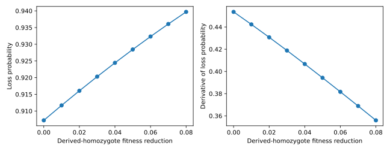

# Sensitivity to selection

How much does selection change the probability that a new allele is lost within
20 generations? Differentiate that finite-time loss probability, then compare
the derivative with central finite differences. The population has 32 diploid
individuals, starts with one derived copy, and has no mutation or immigration.



## Calculation

After [installing drifft](../index.md#installation), save the code below as
`selection_sensitivity.py` and run `uv run --with matplotlib python selection_sensitivity.py`.
Matplotlib is needed only for plotting.

```python
import equinox as eqx
import jax
import jax.numpy as jnp
import matplotlib.pyplot as plt
import drifft

jax.config.update("jax_enable_x64", True)
model = drifft.DemographicTransition(
    drifft.Demography(ne=[32, 32], generations=[20]),
    backend=drifft.FFT,
    method=drifft.Sequential(),
    frequency_map=drifft.AdditiveSelection(s_het=0.01),
)
initial = jnp.zeros(65).at[1].set(1.0)

def loss_probability(s_het):
    updated = eqx.tree_at(lambda m: m.frequency_map.s_het, model, s_het)
    return updated.advance(initial).distribution[0]

value_and_gradient = jax.jit(jax.value_and_grad(loss_probability))
strengths = jnp.linspace(0.0, 0.04, 9)
values, gradients = [], []
for strength in strengths:
    value, gradient = value_and_gradient(strength)
    values.append(float(value))
    gradients.append(float(gradient))

strength = jnp.asarray(0.01)
value, gradient = value_and_gradient(strength)
print(f"Loss after 20 generations: {value:.6f}")
print(f"Derivative at s_het=0.01: {gradient:.6f}")
for step in [1e-4, 1e-5, 1e-6]:
    finite_difference = (
        loss_probability(strength + step) - loss_probability(strength - step)
    ) / (2 * step)
    print(f"step={step:.0e}: finite difference={finite_difference:.6f}")
    assert jnp.isclose(finite_difference, gradient, rtol=1e-5, atol=1e-8)

fig, axes = plt.subplots(1, 2, figsize=(9, 3.5))
axes[0].plot(strengths, values, marker="o")
axes[0].set(xlabel="Heterozygote fitness reduction", ylabel="Loss probability")
axes[1].plot(strengths, gradients, marker="o")
axes[1].set(xlabel="Heterozygote fitness reduction", ylabel="Derivative of loss probability")
fig.tight_layout()
fig.savefig("selection_sensitivity.svg")
plt.show()
```

## Interpretation

A positive derivative means that increasing the fitness penalty increases loss
probability locally. Its magnitude is in probability per unit of
$s_{\mathrm{het}}$: multiply it by a small coefficient change to estimate the
change in loss probability. It is not a confidence interval or an estimate of
the selection coefficient.

The model and numerical geometry are prepared once. `eqx.tree_at` replaces
only the selection parameter, so the derivative follows that parameter through
the complete 20-generation calculation. The full distribution retains absorbed
mass, making its first entry the probability of loss by the final time.

Agreement across several finite-difference step sizes checks the automatic
derivative of this numerical calculation. It does not establish accuracy for
the exact Wright–Fisher transition; use a dense reference for small populations
and tighter backend settings for your intended workload.

See [accuracy and differentiation](../guide/numerics.md) for validation and
[population histories](../guide/demography.md) for longer or changing-size models.
